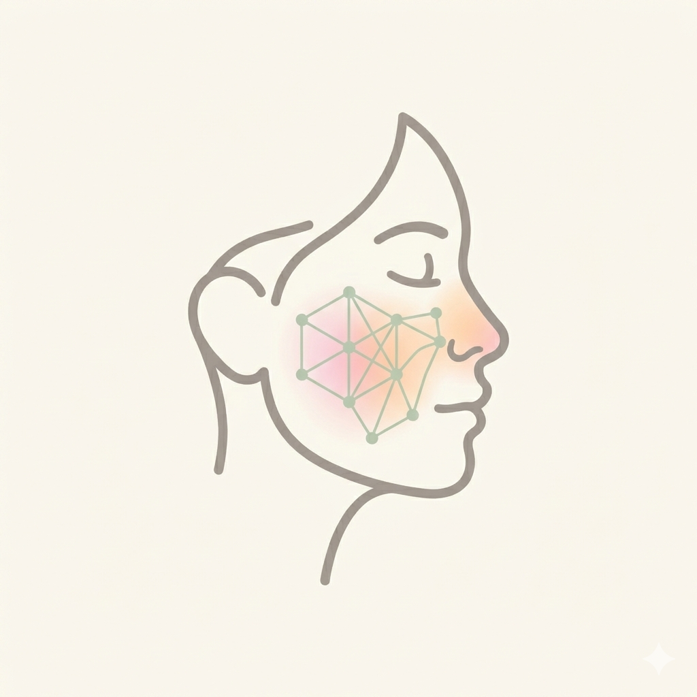

# 🩺 IADerm — Análisis Inteligente de la Piel con Edge AI

<div align="center">
  
  <p><strong>Detección, seguimiento y asistencia para el cuidado dermatológico y facial desde tu móvil.</strong></p>

  [](https://developer.android.com/)
  [](https://www.java.com/)
  [](https://www.tensorflow.org/lite)
  [](https://ai.google.dev/)
  [](LICENSE)
</div>

---

## 📌 Descripción del Proyecto

**IADerm** es una solución móvil integral diseñada para el análisis temprano y monitoreo continuo de afecciones dermatológicas y rojez facial (como eritema y rosácea). Combina modelos de visión por computadora optimizados para ejecutarse en el dispositivo (**Edge AI**) y un asistente conversacional inteligente impulsado por **Google Gemini AI**.

La aplicación garantiza la **privacidad total del usuario**: el procesamiento biométrico y análisis de imagen se realiza 100% de manera local sin enviar fotografías a servidores externos.

---

## ✨ Características Principales

- 📸 **Captura Guiada e Inteligente**: Utiliza **CameraX** y **ML Kit Face Detection** para validar en tiempo real iluminación adecuada, encuadre, distancia óptima y estabilidad del rostro antes de procesar la captura.
- 🧠 **Diagnóstico On-Device (Edge Computing)**: Inferencia local mediante **TensorFlow Lite** a partir de un modelo **MobileViT** ajustado (*fine-tuned*) específicamente para clasificación cutánea.
- 🔥 **Mapa de Calor (Heatmap Overlay)**: Representación visual que resalta las zonas de mayor intensidad o inflamación detectadas en el rostro.
- 📊 **Historial y Métricas de Evolución**: Almacenamiento local con **Room Database** para registrar análisis históricos, calcular tendencias y visualizar gráficas de progreso de los últimos 30 días.
- 📝 **Diario de Desencadenantes (Triggers)**: Registro de factores ambientales y de estilo de vida (exposición solar, estrés, alimentos picantes, clima, cambios en rutina) para detectar correlaciones con los brotes.
- 💬 **Asistente Virtual con Gemini**: Chatbot con IA generativa que contextualiza el perfil del usuario, hábitos y puntuaciones recientes para brindar recomendaciones educativas y personalizadas de cuidado dérmico.
- 📄 **Exportación de Reportes en PDF**: Generación de informes listos para compartir con un dermatólogo certificado durante consultas médicas.

---

## 🛠️ Stack Tecnológico

### Aplicación Android
- **Lenguaje**: Java / Android SDK (Min SDK: 26, Target SDK: 34)
- **Arquitectura**: MVVM (Model-View-ViewModel) con Android Jetpack (`ViewModel`, `LiveData`)
- **Cámara & Visión**: Android CameraX + Google ML Kit Face Detection
- **Base de Datos Local**: Room Persistence Library (SQLite)
- **Motor de Inferencia**: TensorFlow Lite Runtime & TFLite Support Library
- **UI / Componentes**: Material Design 3, ViewPager2, Custom Views (`HeatmapOverlayView`, `FaceGuideView`, `TrendChartView`)

### Pipeline de Inteligencia Artificial (Python)
- **Frameworks**: PyTorch, Hugging Face `transformers` y `datasets`
- **Modelo Base**: `apple/mobilevit-small` (Vision Transformer ligero para dispositivos móviles)
- **Entrenamiento**: Estrategia de 2 fases (calentamiento de cabezal clasificador + *fine-tuning* completo con aumento de datos y precisión mixta `fp16`)
- **Conversión & Exportación**: Exportación a ONNX y conversión optimizada a formato `.tflite` vía `onnx2tf`

---

## 📂 Estructura del Repositorio

```text
├── app/                      # Código fuente de la aplicación Android
│   ├── src/main/assets/      # Modelo TFLite (dermatology_model.tflite)
│   ├── src/main/java/.../    # Actividades, ViewModels, Room DB y Clasificador
│   └── src/main/res/         # Vistas XML, layouts, recursos gráficos y temas
├── convert_to_tflite.py      # Script de conversión PyTorch -> ONNX -> TFLite
├── proyecto.txt              # Pipeline de entrenamiento y fine-tuning con PyTorch
├── build.gradle.kts          # Configuración del proyecto Gradle
└── logo.png                  # Identidad gráfica de la aplicación
```

---

## 🚀 Puesta en Marcha

### 1. Clonar el repositorio
```bash
git clone https://github.com/TU_USUARIO/IADerm.git
cd IADerm
```

### 2. Configurar la API Key de Gemini
Para activar el asistente conversacional, agrega tu clave de API en el archivo `local.properties` en la raíz del proyecto:
```properties
gemini.api.key="TU_GEMINI_API_KEY_AQUI"
```
*(También puedes definirla como variable de entorno `GEMINI_API_KEY`)*.

### 3. Compilar y Ejecutar
Abre el proyecto en **Android Studio** (Hedgehog o superior) y sincroniza los archivos de Gradle. Conecta un dispositivo físico o emulador (Android 8.0 Oreo / API 26+) y haz clic en **Run**.

---

## ⚠️ Descargo de Responsabilidad Médica (Medical Disclaimer)

> **IADerm es una herramienta informática educativa y de seguimiento de bienestar.**  
> No constituye un dispositivo médico ni reemplaza el diagnóstico, valoración clínica ni prescripción de un profesional médico o dermatólogo certificado. Ante cualquier síntoma severo o persistente, consulta a un especialista de la salud.

---

## 📄 Licencia

Este proyecto se distribuye bajo la licencia [MIT](LICENSE).
